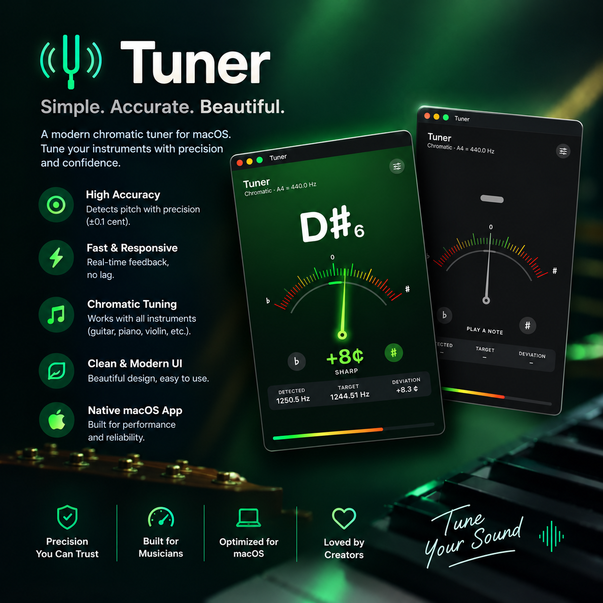

# 🎵 Octavia Tuner

**A sleek, modern chromatic instrument tuner for macOS.**

Octavia Tuner is a native macOS application designed to make tuning instruments simple, intuitive, and visually satisfying. Featuring a clean dark interface, vibrant tuning indicators, and real-time pitch information, it helps you see exactly how sharp or flat a note is.

  

      
---

## ✨ Features

- 🎼 **Chromatic Tuning** — Detect notes across the musical scale.
- 🎯 **Real-Time Pitch Detection** — See the detected note and its deviation from the target frequency.
- 📊 **Visual Tuning Meter** — Easily identify whether a note is flat, sharp, or in tune.
- 🎚️ **Reference Frequency** — Uses A4 = 440 Hz as the reference tuning standard.
- 🔍 **Frequency Details** — View detected frequency, target frequency, and deviation in cents.
- 🌑 **Modern Dark Interface** — A sleek macOS-inspired design with subtle gradients and vibrant accents.

## 🚀 Installation

1. Download the latest version from the [Releases](../../releases) page.
2. Open the downloaded `.dmg` file.
3. Drag **Octavia Tuner** into your **Applications** folder.
4. Open Octavia Tuner and enjoy!

> **Note:** Octavia Tuner requires a Mac running a compatible version of macOS.

## 🛠️ Built With

- **Swift**
- **SwiftUI**
- **Xcode**
- Native macOS technologies

## 🎸 Who Is It For?

Octavia Tuner is designed for musicians who want a straightforward, visually intuitive tuner without an unnecessarily complicated interface. Its chromatic approach makes it suitable for tuning a variety of instruments.

## 🗺️ Roadmap

There's more to come! Potential improvements include:

- [ ] Custom reference tuning frequency
- [ ] Instrument-specific tuning presets
- [ ] Expanded tuning and calibration options
- [ ] Improved tuning history and note visualization
- [ ] And more!

## 🤝 Contributing

Suggestions, bug reports, and contributions are welcome!

If you have an idea to improve Octavia Tuner or encounter a bug, feel free to [open an issue](../../issues) or submit a pull request.

## 📄 License

Octavia Tuner does not currently specify a license. A license may be added in the future to clarify how the project can be used, modified, and distributed.

---

  Made with 🎵 for musicians.

